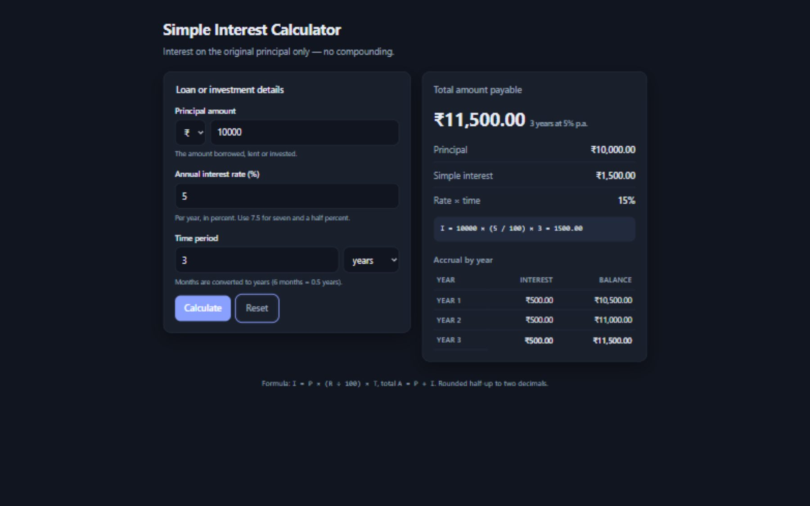

# Simple Interest Calculator

A small calculator that works out simple interest and the total amount payable on a
principal, using the standard simple interest formula. It comes in two flavours that
share the same formula: a command-line tool in plain Python, and a single-file
browser app in HTML and JavaScript.

```
Principal : 10,000.00
Rate      : 5% per year
Time      : 3 years
Interest  : 1,500.00
Total     : 11,500.00
```

## Table of Contents

- [What it does](#what-it-does)
- [The formula](#the-formula)
- [Requirements](#requirements)
- [Installation](#installation)
- [Usage](#usage)
  - [Non-interactive](#non-interactive)
  - [Interactive](#interactive)
  - [Errors](#errors)
- [Web version (HTML + JavaScript)](#web-version-html--javascript)
- [Project structure](#project-structure)
- [How it works](#how-it-works)
- [Running the tests](#running-the-tests)
- [Code of conduct](#code-of-conduct)
- [License](#license)

## What it does

Simple interest is interest that is calculated only on the original principal and
never on interest that has already been earned. This tool takes three inputs:

| Input | Symbol | Meaning | Example |
| --- | --- | --- | --- |
| Principal | `P` | The amount borrowed, invested or lent | `10000` |
| Annual rate | `R` | Interest rate per year, in percent | `5` or `7.5` |
| Time | `T` | Duration of the loan or investment, in years | `3` or `1.5` |

and prints the interest earned and the total amount payable (`P + I`).

Features:

- Accepts whole numbers, decimals and fractional years (`1.5` years = 18 months).
- Money maths uses Python's `Decimal`, so results are not distorted by floating point
  rounding and are always shown to two decimal places, rounded half-up.
- Works non-interactively for scripting or interactively with friendly prompts.
- Validates input and explains what is wrong instead of crashing.
- Covered by a unittest suite.

## The formula

```
I = P * (R / 100) * T
A = P + I
```

Where:

- `I` is the simple interest
- `A` is the total amount (principal plus interest)
- `P` is the principal
- `R` is the annual interest rate in percent
- `T` is the time in years

### Worked example

For a principal of **10,000** at **5%** per year for **3 years**:

```
I = 10000 * (5 / 100) * 3 = 1500
A = 10000 + 1500        = 11500
```

So the interest is **1,500.00** and the total payable is **11,500.00**.

## Requirements

- Python 3.9 or newer (the script uses built-in generics in type hints).
- No external packages.

Check your version with:

```bash
python --version
```

On Windows you can usually use the `py` launcher instead of `python`.

## Installation

Clone the repository and move into it:

```bash
git clone https://github.com/<your-username>/simple-interest-calculator.git
cd simple-interest-calculator
```

There is nothing to install — run the script directly.

## Usage

### Non-interactive

Pass the three values as flags. Every flag has a short form and a long form:

```bash
python simple_interest.py --principal 10000 --rate 5 --time 3
```

```bash
python simple_interest.py -p 2500 -r 7.5 -t 2
```

```
Principal : 2,500.00
Rate      : 7.5% per year
Time      : 2 years
Interest  : 375.00
Total     : 2,875.00
```

Only the flags you supply are used; anything missing is asked for interactively, so
this is also valid:

```bash
python simple_interest.py -p 1000
```

```bash
python simple_interest.py --help
```

### Interactive

Run the script with no arguments and it prompts for each value. Press Enter to accept
the value shown in brackets.

```bash
python simple_interest.py
```

```
Principal [10000]: 5000
Annual rate (%) [5]: 6
Time (years) [3]: 1.5

Principal : 5,000.00
Rate      : 6% per year
Time      : 1.5 years
Interest  : 450.00
Total     : 5,450.00
```

### Errors

Input is checked before anything is calculated:

```
$ python simple_interest.py -p 0 -r 5 -t 3
Error: principal must be greater than 0
```

```
$ python simple_interest.py -p 1000 -r five -t 3
usage: simple_interest.py [-h] [-p PRINCIPAL] [-r RATE] [-t TIME]
simple_interest.py: error: argument -r/--rate: rate must be a number, got 'five'
```

## Web version (HTML + JavaScript)

`index.html` is the whole app — form, result and a year-by-year accrual table in one
file. Open it directly in any modern browser; there is no server, build step or
package to install.



Features:

- Recalculates as you type, so there is nothing to submit except the values.
- Shows the interest, the total amount, and the rate × time factor.
- Prints the formula with your numbers substituted, e.g.
  `I = 10000 × (5 / 100) × 3 = 1500.00`.
- Accepts the time period in **years or months** (18 months becomes 1.5 years).
- Switches currency between ₹, $, € and £; results use thousands separators and two
  decimals, rounded half-up.
- Breaks the interest down year by year, including a partial final year.
- Validates the input and explains what is wrong instead of showing a nonsense result.
- Follows the operating system's light or dark theme.

To use it, double-click `index.html`, or serve the folder if you prefer a URL:

```bash
python -m http.server 8000
```

then open `http://localhost:8000/`.

The same worked example as above gives **1,500.00** interest and **11,500.00** in
total, so both front ends agree.

## Project structure

```
simple-interest-calculator/
├── simple_interest.py         # the calculator (CLI + formula)
├── index.html                 # browser version (HTML + JavaScript)
├── test_simple_interest.py    # unittest suite for the formula
├── screenshot.jpg             # the web version in action
├── README.md                  # this file
├── LICENSE                    # Apache License 2.0
├── CODE_OF_CONDUCT.md         # Contributor Covenant 2.1
└── .gitignore                 # Python bytecode and virtual environments
```

## How it works

The calculation lives in one small function so it can be reused and tested
independently of the command line:

```python
def simple_interest(principal, rate, time):
    interest = principal * (rate / Decimal(100)) * time
    total = principal + interest
    return interest.quantize(TWO_PLACES, ROUND_HALF_UP), total.quantize(TWO_PLACES, ROUND_HALF_UP)
```

1. `build_parser()` defines the `argparse` interface and converts each value to a
   `Decimal`, raising a readable error for anything that is not a finite number.
2. Any value not given on the command line is collected by `prompt()`, which offers a
   default when you just press Enter.
3. `validate()` rejects a principal or time that is zero or negative and a negative
   rate, since none of those describe a real loan.
4. `simple_interest()` applies `I = P * (R / 100) * T` and rounds both results to two
   decimal places, half-up, which is the usual convention for currency.
5. `main()` prints a short, aligned summary.

## Running the tests

```bash
python -m unittest -v
```

```
test_fractional_rate ... ok
test_fractional_time ... ok
test_rounds_half_up_to_two_places ... ok
test_whole_numbers ... ok
test_zero_rate_returns_principal ... ok

Ran 5 tests in 0.001s

OK
```

The suite covers whole numbers, a fractional rate, a fractional time, a zero rate, and
rounding to two decimal places.

## Code of conduct

This project follows the [Contributor Covenant](https://www.contributor-covenant.org),
version 2.1. The full text lives in [`CODE_OF_CONDUCT.md`](CODE_OF_CONDUCT.md) and
covers Our Pledge, Our Standards, Enforcement Responsibilities, Scope, Enforcement,
Enforcement Guidelines and Attribution.

Report abusive, harassing or otherwise unacceptable behaviour to
<31242526@vupune.ac.in>. All complaints are reviewed and investigated promptly and
fairly, and the privacy of the reporter is respected.

## License

Released under the **Apache License 2.0**. The full text is in the
[`LICENSE`](LICENSE) file and covers definitions, the grant of copyright and patent
licenses, redistribution, submission of contributions, trademarks, disclaimer of
warranty, limitation of liability, and accepting warranty or additional liability.

You may also read it at <https://www.apache.org/licenses/LICENSE-2.0>.
